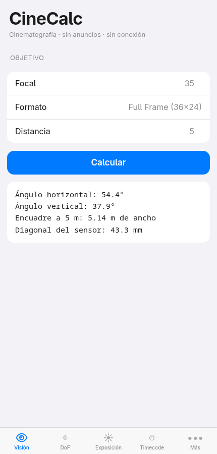
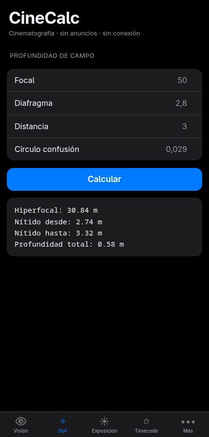

# CineCalc

Calculadoras de cinematografía en una **PWA**: funciona en Android (instalable desde el navegador) y en el PC, sin cuentas, sin anuncios y **sin conexión**.

## Calculadoras

- **Campo de visión**: ángulo horizontal/vertical y ancho encuadrado a una distancia, por formato de sensor.
- **Profundidad de campo**: hiperfocal, distancia nítida cercana/lejana y profundidad total.
- **Exposición y ND**: velocidad de obturación por ángulo, equivalencia con filtros ND.
- **Timecode y bitrate**: timecode final, duración y tamaño estimado del archivo.
- **Equivalencia de objetivo**: factor de recorte y focal equivalente entre formatos.
- **Encuadre**: previsualización del cuadro con rejilla de tercios, relación de aspecto y figura de referencia a escala.
- **Comparar objetivos**: 3 focales a la vez (ángulo, ancho encuadrado y profundidad de campo).

Interfaz estilo app de iPhone (iOS), con modo claro y oscuro automático:

| Claro | Oscuro |
|---|---|
|  |  |

## Uso

- **PC**: abre `index.html` en el navegador (o sirve la carpeta con cualquier servidor estático).
- **Android**: abre la URL publicada y usa «Añadir a pantalla de inicio» (PWA).

## Por qué existe

No se puede modificar y redistribuir la app propietaria «Movie Calc» (copyright).
Esto es una implementación propia (clean-room) con las fórmulas estándar de óptica
y exposición, publicada como software libre.

## Licencia

MIT.
